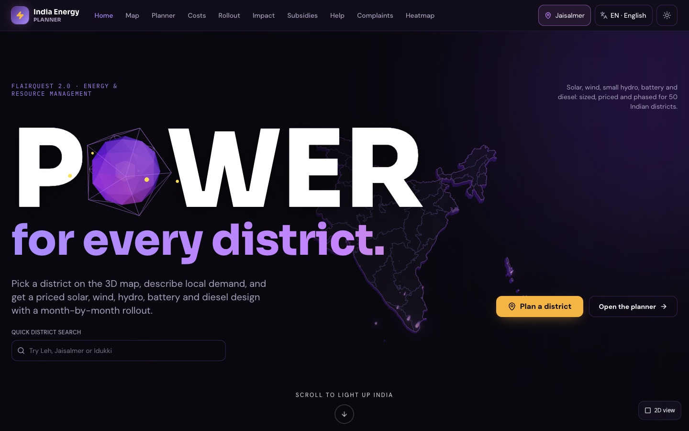
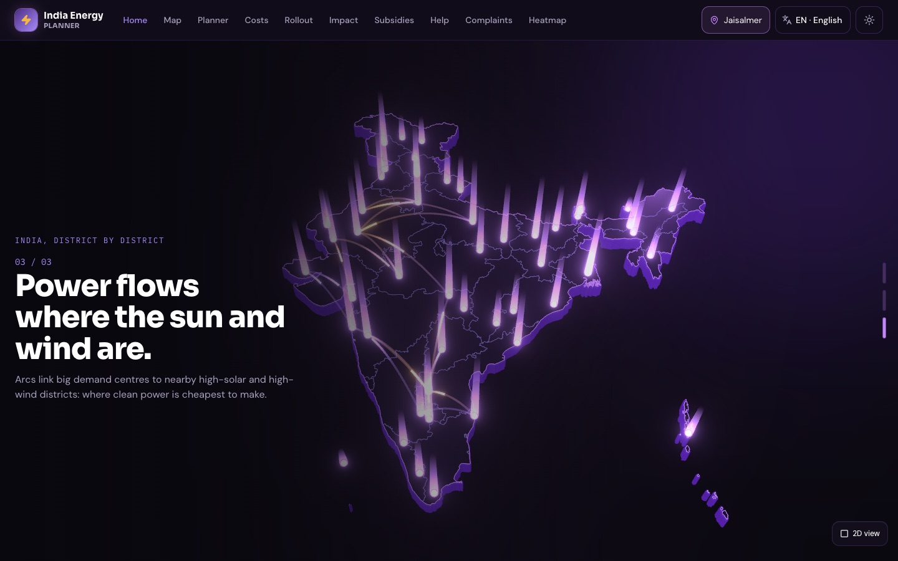
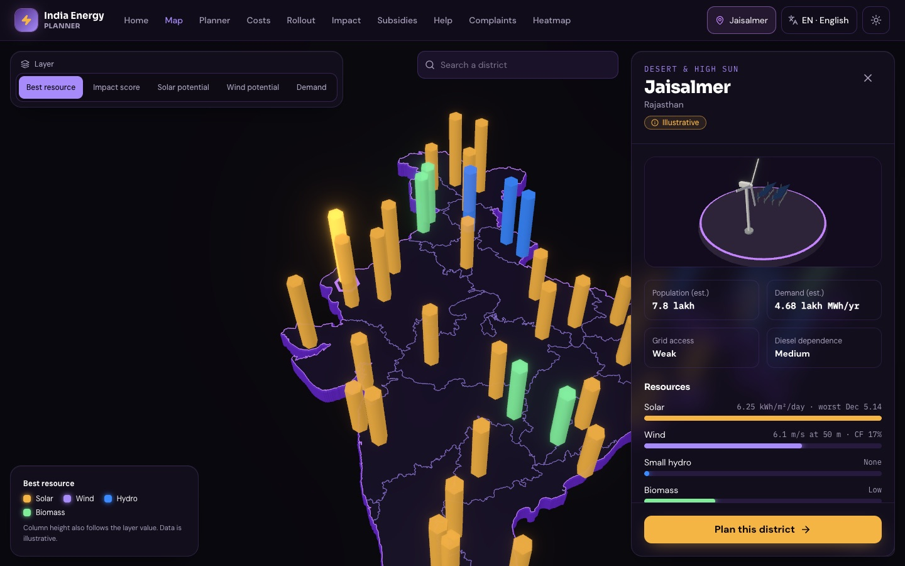
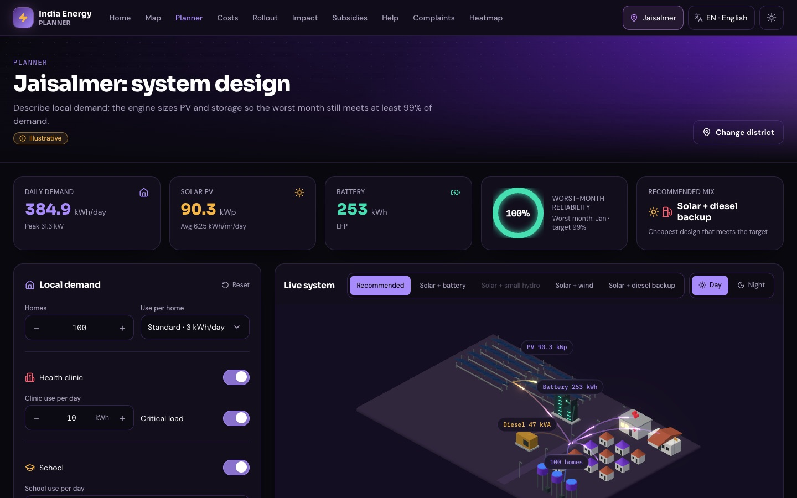
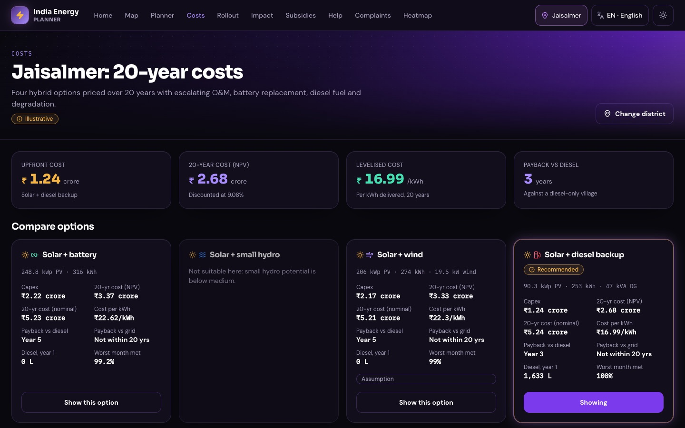
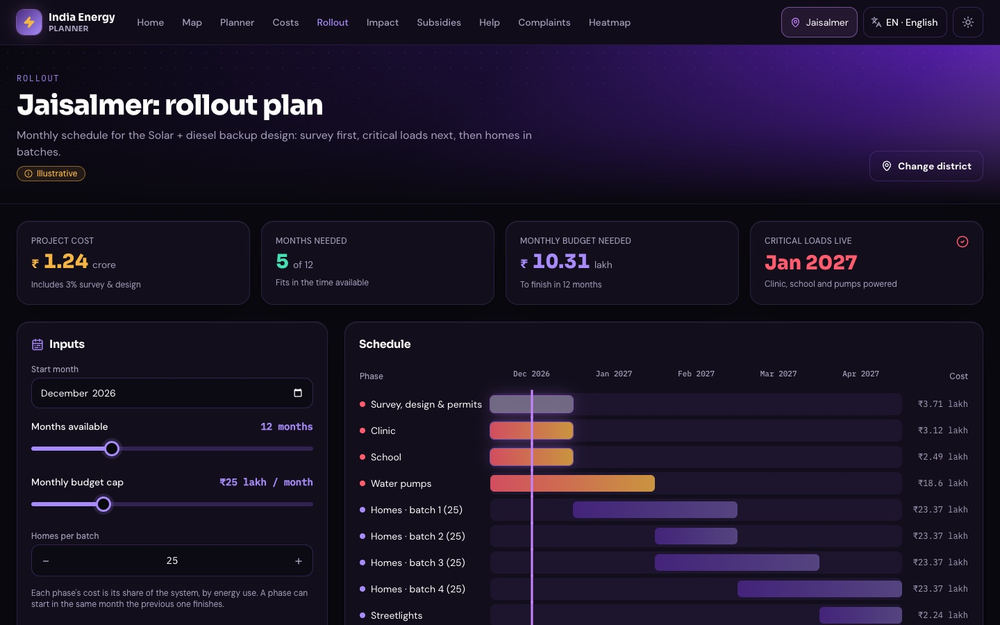
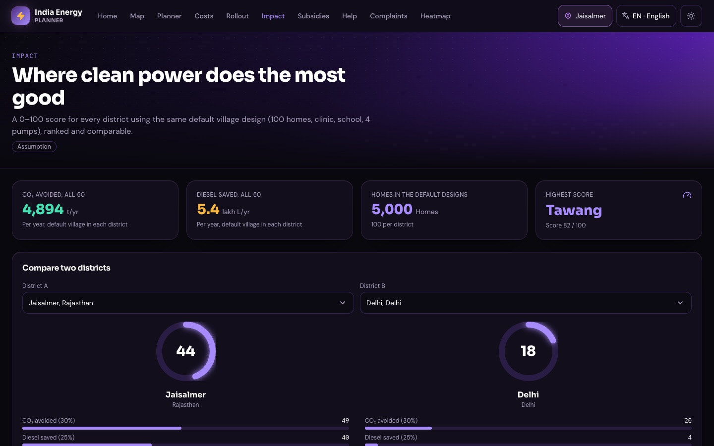
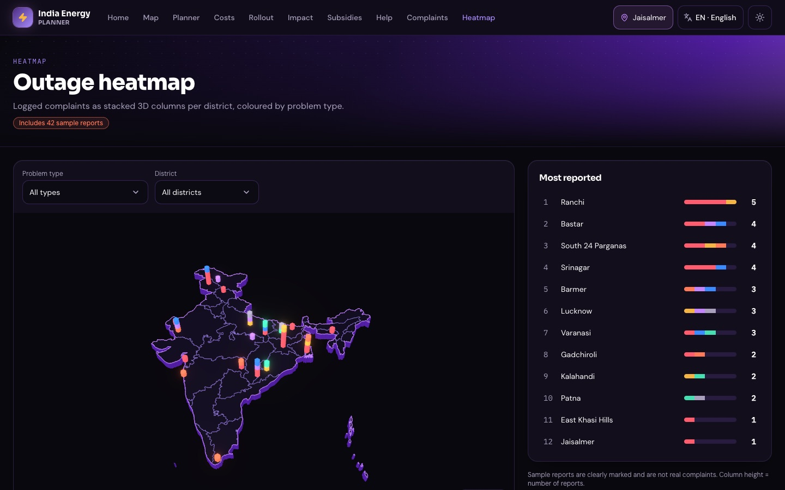
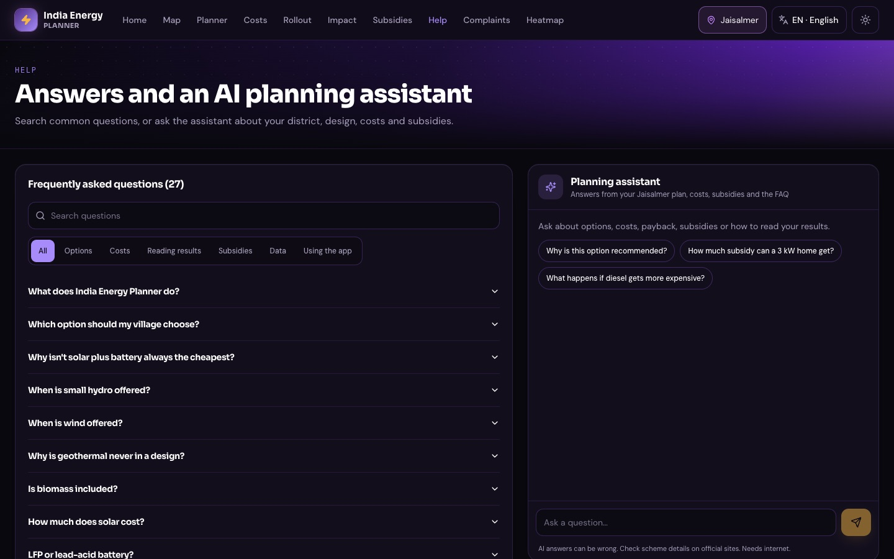

<div align="center">

# ⚡ India Energy Planner

**Plan clean, reliable power for any Indian district: from a 3D map to a priced, month-by-month rollout.**

FlairQuest 2.0 Ideathon · Track 8: Energy & Resource Management

[](https://github.com/adityashukla44/india-energy-planner/actions/workflows/ci.yml)




</div>

---

## Overview

Pick an Indian district on a 3D map, see its energy profile, describe local demand (homes, a clinic, a school, water pumps, streetlights), and get an auto-designed solar / wind / small-hydro / battery / diesel system. The app prices it over 20 years and plans a month-by-month rollout.

It also finds matching subsidies, ranks all 50 districts by impact, answers questions through an AI assistant, and lets people log and track power complaints (with a 3D outage heatmap). It works in English, Hindi, Tamil and Bengali, and offline after the first visit.

## Features

| | |
|---|---|
| 🗺️ **3D India map** | Survey of India based boundary (incl. all of J&K and Ladakh), district columns by best resource, impact, solar, wind or demand |
| 🔆 **System planner** | Builds demand from loads, then sizes PV, battery, wind, small hydro and diesel backup to hit ≥ 99% worst-month reliability |
| 💰 **20-year costs** | Capex, NPV, LCOE and payback vs diesel and grid, with every assumption adjustable |
| 📅 **Rollout plan** | Month-by-month timeline from survey to commissioning |
| 🌱 **Impact ranking** | All 50 districts ranked by impact score, CO₂ and diesel avoided |
| 🏛️ **Subsidies** | Matches central and state schemes to the chosen design |
| 💬 **AI assistant** | Claude-powered help that knows the current plan; falls back to FAQ search offline |
| 📣 **Complaints + heatmap** | Log and track power complaints, queued offline, shown on a 3D outage heatmap |
| 🌐 **4 languages** | English, हिन्दी, தமிழ், বাংলা with Indian number format (lakh, crore) |
| 📶 **Works offline** | Installable PWA; all pages and data cached after the first visit |

## Screenshots

<table>
  <tr>
    <td width="50%"><br><sub><b>Home</b> · scroll-driven India map</sub></td>
    <td width="50%"><br><sub><b>Map</b> · districts by best resource</sub></td>
  </tr>
  <tr>
    <td><br><sub><b>Planner</b> · auto-sized system and 3D scene</sub></td>
    <td><br><sub><b>Costs</b> · 20-year lifecycle</sub></td>
  </tr>
  <tr>
    <td><br><sub><b>Rollout</b> · month-by-month plan</sub></td>
    <td><br><sub><b>Impact</b> · district ranking</sub></td>
  </tr>
  <tr>
    <td><br><sub><b>Heatmap</b> · complaints by district</sub></td>
    <td><br><sub><b>Help</b> · AI assistant and helplines</sub></td>
  </tr>
  <tr>
    <td colspan="2"><br><sub><b>Multilingual</b> · the planner in Hindi</sub></td>
  </tr>
</table>

## Tech stack

| Layer | Tools |
|---|---|
| Web app | Vite 5, React 18, TypeScript, Tailwind CSS, Framer Motion, Zustand, i18next, Recharts |
| 3D | three.js, @react-three/fiber, @react-three/drei, postprocessing |
| Offline | vite-plugin-pwa (Workbox), IndexedDB queue |
| Server | Express, TypeScript, better-sqlite3, zod, helmet, express-rate-limit |
| AI | Anthropic SDK (`claude-opus-5-5`, streaming) |
| Testing | Vitest (unit), Playwright (end-to-end) |

## Getting started

**Requirements:** Node 22 or newer (tested on Node 26).

```bash
git clone https://github.com/adityashukla44/india-energy-planner.git
cd india-energy-planner
npm install
cp .env.example .env
npm run seed     # load the 42 sample complaints (marked "Sample") for the heatmap
npm run dev      # API on :8787, web app on http://localhost:5173
```

### Scripts

| Command | What it does |
|---|---|
| `npm run dev` | API on :8787 and web app on http://localhost:5173 |
| `npm test` | Unit tests (Vitest): engine, subsidies, FAQ search, chat streaming, translations |
| `npm run test:e2e` | Playwright smoke test: every page, desktop + phone, offline mode (first run: `npx playwright install chromium`) |
| `npm run build` | Production build (includes the service worker) |
| `npm start` | Serves the built app + API on `PORT` (default 8787) |
| `npm run seed` | Loads sample complaints into SQLite |
| `npm run import:nasa` | Imports NASA POWER CSVs from `data-raw/` |
| `npm run data:districts` | Regenerates illustrative district data |

### Environment variables

| Variable | What it does |
|---|---|
| `ANTHROPIC_API_KEY` | Turns on the AI assistant on the Help page. Without it, the assistant answers from the FAQ instead. Never sent to the browser. |
| `ANTHROPIC_MODEL` | Optional. Defaults to `claude-opus-5-5`. |
| `ADMIN_TOKEN` | Required to change a complaint's status (`PATCH /api/complaints/:id/status`). |
| `PORT` | API / production server port (default 8787). |
| `DB_PATH` | Optional. SQLite file location (use a persistent disk in production). |

## Project structure

```
india-energy-planner/
├── client/                  Vite + React 18 + TypeScript + Tailwind
│   ├── public/data/         all data as JSON: districts, costs, india-boundary, subsidies, helplines, faq, sample-complaints
│   └── src/
│       ├── engine/          pure planning maths (resource, demand, sizing, costs, lifecycle, rollout, impact, plan) + tests
│       ├── three/           react-three-fiber scenes (hero, 3D map, district diorama, system scene, procedural models)
│       ├── pages/           one route per page
│       ├── components/      layout, UI kit, planner widgets, charts
│       ├── lib/             data loading, hooks, AI assistant client, offline complaints
│       └── i18n/            en, hi, ta, bn strings
├── server/                  Express + TypeScript (helmet, cors, rate limit, zod), SQLite via better-sqlite3
│   └── src/routes/          health, complaints, chat
├── e2e/                     Playwright smoke tests
├── scripts/                 data tools (district generator, NASA POWER import)
├── data-raw/                NASA POWER CSV drop folder
├── docs/                    API, data, deployment guides and screenshots
├── Dockerfile · render.yaml deployment configs
└── .github/                 CI workflow and issue / PR templates
```

**Pages:** Home · Map · Planner · Costs · Rollout · Impact · Subsidies · Help · Complaints · Heatmap · Data & Assumptions.

## Documentation

- 📡 [API reference](docs/API.md): endpoints, examples, security
- 📊 [Data, sources and assumptions](docs/DATA.md): updating data, sources, map boundary, sizing assumptions, translations
- 🚀 [Deployment](docs/DEPLOYMENT.md): Render, Docker, offline/PWA
- 🤝 [Contributing](CONTRIBUTING.md): workflow, branch and commit conventions

## Important notes

- District resource values are **illustrative** until NASA POWER data is imported.
- The map boundary is **flagged for verification** against the Survey of India's official political map before publishing.
- A native speaker must review the Hindi, Tamil and Bengali translations before public use.

## Team

| | |
|---|---|
| [@adityashukla44](https://github.com/adityashukla44) | Owner |
| [@KushP246](https://github.com/KushP246) | Contributor |
